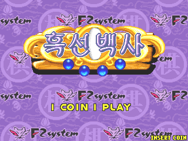
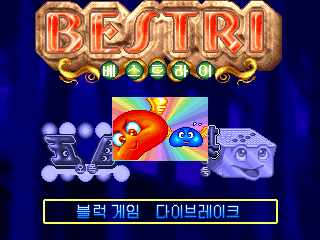
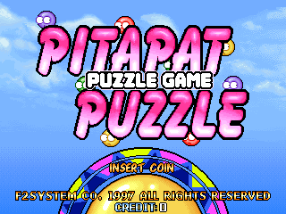

# Cross Pang / Heuk Sun Baek Sa / Bestri / Pitapat Puzzle (F2 System) for MiSTer

The four games of MAME's `f32/crospang.cpp` driver, F2 System's bootleg-style "Tumble Pop" board (68000 at 7.16 MHz, Pitapat Puzzle
at 14.32 MHz; Z80 with a YM3812 and an OKI M6295; two 16 x 16 tilemaps and a DECO 52-style sprite generator in its bootleg mode), for
the MiSTer FPGA platform:

| Game | Set | MRA |
|---|---|---|
| Cross Pang (1998) | `crospang` | `mra/Cross Pang.mra` |
| Heuk Sun Baek Sa (Korea, 1997) | `heuksun` | `mra/Heuk Sun Baek Sa (Korea).mra` |
| Bestri (Korea, set 1, 1998): Die Break, Heuk Sun Baek Sa and Penta | `bestri` | `mra/Bestri (Korea, set 1).mra` |
| Bestri (Korea, set 2) | `bestria` | `mra/_alternatives/_Bestri/Bestri (Korea, set 2).mra` |
| Pitapat Puzzle (set 1, 1997) | `pitapat` | `mra/Pitapat Puzzle (set 1).mra` |
| Pitapat Puzzle (set 2) | `pitapata` | `mra/_alternatives/_Pitapat Puzzle/Pitapat Puzzle (set 2).mra` |

| Cross Pang | Heuk Sun Baek Sa |
|---|---|
|  |  |
| **Bestri** | **Pitapat Puzzle** |
|  |  |

The title screens as MAME 0.289 draws them.

Written for MiSTer from MAME 0.289's driver and its sprite chip (`decospr.cpp`). The 68000 is [fx68k](https://github.com/ijor/fx68k)
(Jorge Cwik), the Z80 is [TV80](https://github.com/hoglet67/tv80) (Guy Hutchison), the YM3812 is jtopl2 of
[jtopl](https://github.com/jotego/jtopl) and the OKI M6295 [jt6295](https://github.com/jotego/jt6295) (Jose Tejada), the CRT Adjust page
is rmonic79's [MiSTer-CRT-Adjust](https://github.com/rmonic79/MiSTer-CRT-Adjust). The platform layer (SDRAM controller, loader, program
cache) is the owner's, from the Oh My God!, MCatAdv and Metro cores; the SDRAM controller descends from the Gaiapolis core that
**plasticbugs** wrote for the Analogue Pocket. Fast loading and the Scale option come from the owner's Monster Maulers / Violent Storm
cores (`rtl/UPSTREAM.md`, `modules/VENDOR.md`). No ROMs or other copyrighted data are in this repository; you supply your own MAME
romsets.

## Status

**Tested on a real MiSTer** by the repository owner: all six sets load and play; the picture, the sound, the controls (the third
button too), the DIP switches, CRT Adjust, Scale and fast loading work.

What was checked besides, in simulation and in the Quartus tool flow, against MAME 0.289 (details and numbers in `docs/status.md`):

* The ROM path: all 30 regions of the six sets are byte-identical to what MAME loads (`tools/crospang_rom.py check`), the loader's
  graphics remap decodes all 166,912 tiles exactly as MAME's gfx layouts (`tools/crospang_image.py check`), and the MRAs assemble
  to the core's images with the md5 MiSTer computes (`tools/make_mra.py`, `tools/mra_build.py`).
* The video, against a reference renderer (`tools/crospang_ref.py`) that is MAME's `screen_update` and `decospr` written out: 0
  differing pixels on 1,358 MAME frames of all six sets; the RTL's frozen-state bench against the same MAME pixels: 298 of 298
  states pixel-identical.
* The whole machine from reset with MAME's inputs replayed: Cross Pang's frames 266 to 311 (the mode select and the start of play)
  pixel-identical to MAME's; Pitapat Puzzle exact, one frame ahead.
* The sound: the Z80's YM3812 traffic is MAME's frame by frame; the OKI's level within 0.5 dB of MAME's recording, the YM3812's
  within 0.6 dB (envelope correlation 0.986).
* The fast load against a DDR3 model, word by word; the framework's scandoubler with every Scandoubler Fx setting and CRT Adjust
  (`sim/sd/sweep.sh`).
* Quartus Prime Lite 17.0 compiles the design without errors; timing met (+0.44 ns at 96 MHz), 32 % of the ALMs.

## Install

1. Unzip `CrossPang_MiSTer_<date>.zip` (from the GitHub release) over the root of the SD card: it puts the MRAs in `_Arcade/` (the
   second sets in `_Arcade/_alternatives/`) and the core in `_Arcade/cores/`. From the repository instead: `releases/crospang_YYYYMMDD.rbf`
   to `/media/fat/_Arcade/cores/` and the contents of `mra/` to `/media/fat/_Arcade/`. Keep the RBF's `crospang_` name and date:
   MiSTer finds the core by the MRA's `<rbf>` name plus the date. Delete older `crospang_*.rbf` files.
2. Put your MAME 0.289 romsets in `/media/fat/games/mame/`: `crospang.zip`, `heuksun.zip`, `bestri.zip`, `pitapat.zip` (merged sets
   hold the second sets; with split sets add `bestria.zip` and `pitapata.zip`).
3. Start a game from the Arcade menu. With a recent Main_MiSTer the ROM loads in a moment (fast loading: the MRAs' `address=` makes
   Main_MiSTer copy the image into the DDR3, the core reads it back in 0.2 s); an older Main_MiSTer ignores it and loads the ordinary
   way, a few seconds.
4. Define the buttons once per game (OSD): each MRA names them, in the order Button 1, Button 2, Button 3, Start, Coin.

## Controls

A 4-way joystick per player, Start and Coin; on the keyboard, MAME's defaults (1 / 2 start, 5 / 6 coin). The buttons:

| Game | Button 1 | Button 2 | Button 3 |
|---|---|---|---|
| Cross Pang | **Pick/Drop**: picks up / drops the ball under the ring | **Power** | **More Balls** |
| Heuk Sun Baek Sa | **Place Stone** | **Menu (Hint/Undo)**: retry, take back a move, give up, hint | - |
| Bestri | **Launch/Place**: Die Break launches the ball; Heuk Sun Baek Sa and Penta place a stone | **Jump/Menu**: Die Break jumps; Heuk Sun Baek Sa's menu | - |
| Pitapat Puzzle | **Pick/Swap/Drop**: picks up / exchanges / drops a marvel | **More Marvels** | **Boxes to Marvels**: the boxes on your field become marvels (as often as the "x1" card at the top left says) |

The names come from the games' own help texts and from pressing each button in MAME. Cross Pang's third button goes beyond MAME
0.289, which leaves that input unknown: the game's demo shows buttons A, B and C, and C brings up new balls. Bestri's game is chosen
with the joystick on its title screen before Start.

There is no service button: every game reads its DIP switches only once, while it boots. For the test mode set the **Service Mode**
DIP switch and reset the core (as in MAME).

## OSD

* **Aspect ratio**, **Scale** (Normal, V-Integer, HV-Integer, Narrower HV-Integer, HV-Integer+): for the HDMI scaler; with Full
  Screen and an integer Scale the screen's own proportions stand in, so the picture stays a whole-number size.
* **Scandoubler Fx** (HQ2x, CRT 25 / 50 / 75 %): the framework's.
* **CRT Adjust** (H-Size, H-Position, V-Shift): for the 15 kHz output, through rmonic79's line buffer; the horizontal sync stays
  native so the CRT keeps its lock. It is off while the scandoubler is in use (Scandoubler Fx or MiSTer.ini's `forced_scandoubler`):
  its blanking would leave the doubled picture without a vertical sync.
* **DIP switches**: each game's, as MAME 0.289 defines them, with MAME's defaults. The games read them at boot: reset after a change.
* **Volume**: Normal is MAME's mix (the YM3812 plus 16 times jt6295's sum, both at MAME's route 1.0, clipped to 16 bits), then 6 / 12
  / 18 dB lower.
* **Video RAM**: all four games rewrite their sprite list and both tilemaps every frame, 0.05 to 5.5 ms after the interrupt, longer
  than the vertical blank. *At vblank (MAME)* (default) copies the tile and sprite RAMs and the scroll / bank registers at the start
  of vertical blank and draws the next frame from the copy, as MAME draws a frame. *Live (less lag)* reads them as each line is
  drawn: the picture is one frame newer, and an object moving in the top lines while the game rewrites them can tear (no difference
  was visible on the owner's MiSTer). The palette is always looked up as the dots go out.
* **SDRAM read capture**: a diagnostic for SDRAM modules that answer late.

## Timing

96 MHz machine clock; 68000 7.159 MHz (14.318 MHz for Pitapat Puzzle, as MAME runs it), Z80 and YM3812 3.579545 MHz, OKI 894.886 kHz
(pin 7 high), dot clock 6 MHz (/16); 384 x 260 total, 320 x 240 visible, 60.096 Hz, 15.625 kHz. MAME gives a 320 x 240 window at
exactly 60 Hz with no vertical blank time; the board's real timing is not known.

## Build

Quartus Prime Lite 17.0 (MiSTer's toolchain): open `Crospang.qpf` or `quartus_sh --flow compile Crospang`. The MRAs are written by
`python tools/make_mra.py` (it reads MAME 0.289's romsets and `src/mame/f32/crospang.cpp`; `tools/paths.py` says where).

## Simulation (Verilator 5 in WSL)

```
sim/run.sh <image> 2 <out> +state=<MAME state prefix> +first=1 +foff=-1      # one frozen MAME state, vs MAME's pixels
sim/run.sh <image> <frames> <out> +inputs=<replay> +every=10 +first=58 +wav  # the whole machine from reset with MAME's inputs
sim/run.sh <image> 0 <out> +load=fast                                         # the fast load from a DDR3 model, checked word by word
sim/run_opl.sh <ymlog> <seconds> <out.wav>                                    # the YM3812 with MAME's register writes
sim/sd/sweep.sh                                                               # the framework's scandoubler, with CRT Adjust
```
`python tools/crospang_image.py build <set> <out.rom>` makes an image (the bytes the MRA delivers). `tools/capture.py` with
`tools/lua/dump_state.lua` makes MAME 0.289's states and input replays; `tools/crospang_ref.py`, `tools/corpus_rtl.py`,
`tools/sys_match.py` and `tools/cmp_audio.py` compare; `tools/probe.py` and `tools/service.py` press inputs in MAME. They expect a
scratch folder `work/` next to the repository (MAME's dumps and the ROM images; never committed); `tools/paths.py` names the
environment variables for MAME, the romsets and MAME's source.

## Release

`python tools/release.py` copies a finished build into `releases/` with its fitter / timing / RAM-depth reports;
`python tools/package.py` writes `dist/CrossPang_MiSTer_<date>.zip` (the SD card structure: `_Arcade/**/*.mra`, `_Arcade/cores/*.rbf`;
no ROMs).

## Credits

fx68k (Jorge Cwik), TV80 (Guy Hutchison), jtopl and jt6295 (Jose Tejada), MiSTer-CRT-Adjust (rmonic79), the Pocket Gaiapolis core's
SDRAM controller and `mra_build.py` (plasticbugs), the MiSTer framework (Sorgelig and contributors), MAME (Pierpaolo Prazzoli and
David Haywood wrote the F2 System driver; Bryan McPhail and David Haywood the DECO sprite chip). rmonic79's Boogie Wings core and
MiSTer-devel's Arcade-Deco16 core were read as references for the sprite chip.

## Licence

GPL-3.0-or-later (fx68k, jtopl and jt6295 are GPL-3.0, TV80 is MIT, MiSTer-CRT-Adjust GPL-3.0-or-later).
